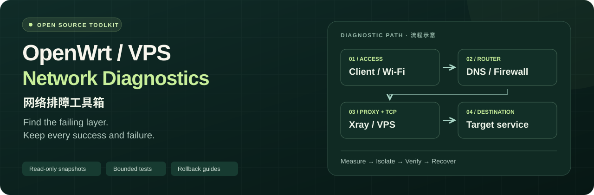

<p align="center">
  
</p>

<p align="center">
  <a href="README.md">简体中文</a> · <strong>English</strong> ·
  <a href="docs/quick-start.md">Quick start / 快速入门</a> ·
  <a href="docs/latest-progress.md">Latest evidence</a>
</p>

<p align="center">
  <a href="https://github.com/wukai8775-max/openwrt-vps-streaming-diagnostics/actions/workflows/ci.yml"></a>
  <a href="LICENSE"></a>
  
</p>

# OpenWrt / VPS Streaming Network Diagnostics

An evidence-led toolkit for **OpenWrt/Kwrt → PassWall/Xray → Linux VPS → target service**. Separate local access, forwarding, cross-border TCP, proxy processing and the destination before changing production settings.

Useful when:

- **Wi-Fi connects, but proxied sites do not load.** Check access, DNS redirection, proxy listeners and firewall policy separately.
- **BBR is enabled, but transfers remain slow.** Inspect the actual sending socket and compare a fixed, complete object.
- **A speed test completes, but a live stream still stalls.** Measure small requests under load, then verify the real phone and application.

Start with one primary path, keep every failed attempt, and test at most one evidence-backed production change. Keeping the current configuration is a valid outcome.

## Start with an offline example

Requires Python 3.10+. Actual transfer tests also require curl 8.4+; no pip dependencies are needed. Linux collectors run through the SSH access you already use.

```sh
git clone https://github.com/wukai8775-max/openwrt-vps-streaming-diagnostics.git
cd openwrt-vps-streaming-diagnostics
python3 tools/summarize.py examples/synthetic-downloads.jsonl
```

Expected result: **3 attempts, 2 complete objects and 1 partial timeout**. Only complete objects contribute to completion-time and task-goodput statistics. This reads a synthetic file; it does not contact a router, VPS or test endpoint.

Preview a bounded test plan without sending traffic:

```sh
python3 tools/download-test.py \
  --url https://download.example.invalid/fixed-10mb.bin \
  --source 192.0.2.10 --bytes 10000000 --repeat 5 --timeout 90 \
  --object-id demo-10MB --group demo-A0 --dry-run
sh tools/snapshot.sh --port 8443 --dry-run
```

These are documentation-only values. `--dry-run` makes **zero network requests**, does not collect live device metrics and does not measure speed. Before any live run, replace the source, exact object URL, SSH aliases and business port with values verified in your own environment.

Follow the [15-minute orientation guide](docs/quick-start.md) (Chinese) for protected result storage, read-only snapshots and the first live-test checklist. Fifteen minutes is an introductory budget, not a promise to diagnose a root cause.

## Choose your next step

| Goal | Read |
|---|---|
| Find the likely layer and avoid common misdiagnoses | [Decision tree](docs/decision-tree.md) |
| Run one bounded investigation | [Eight-hour playbook](docs/eight-hour-playbook.md) |
| Propose one reversible experiment | [Experiment card](docs/experiment-card.md) |
| Verify application behavior and recovery | [Acceptance and rollback](docs/acceptance-and-rollback.md) |
| Review measured results and unresolved issues | [Latest progress](docs/latest-progress.md) |
| Build isolated access groups on the same node | [Segmented AU acceptance](docs/segmented-au-acceptance.md) |

Detailed runbooks and the historical case are currently in Chinese. Commands, tool output and the [latest machine-readable summary](examples/2026-10-13-six-group-speed-summary.json) are readable independently of those narratives.

## What the tools do

| Tool | Purpose | Production configuration changes |
|---|---|---|
| `tools/snapshot.sh` | Read-only Linux/OpenWrt snapshot; missing metrics are explicit | None |
| `tools/sample.sh` | Bounded samples of CPU, counters, queues and selected sockets | None |
| `tools/download-test.py` | Fixed-size HTTPS completion tests with source binding | None; generates bounded traffic |
| `tools/upload-test.py` | Parallel POST streams with a declared payload and rate budget | None; generates bounded traffic |
| `tools/probe.py` | Bound HTTPS / STUN request latency, timeouts and reconnects | None; generates probe traffic |
| `tools/summarize.py` | Offline summary preserving the failure denominator | None |
| `tools/check-publication.py` | Check tracked files for common accidental disclosures | None; does not replace manual review |

A transfer is complete only when curl exits successfully, HTTP status is 200, the exact object byte count matches and the required source check passes. A partial transfer remains a failure. Compare like-for-like objects, targets, directions, timeouts, bindings and rate conditions.

Source binding alone does not prove a transparent proxy mapping or the DNS path. A system default of BBR does not prove that the active sending connection uses BBR. HTTPS request timeouts are not video-packet loss. Public endpoints can refuse or rate-limit tests; preserve those outcomes and respect the service response.

## Latest measured evidence · 2026-10-13

The current evidence contains separate batches, not a combined all-pass result:

| Batch | Complete / attempted | Interpretation |
|---|---:|---|
| Cloudflare, six groups, fixed 10 MB download/upload | **73/84** | Seven AU-group-5 downloads received HTTP 429; four US-main transfers timed out in the connection phase |
| OVH, six groups, fixed 10 MiB downloads | **42/42** | All six groups completed the independent target; this does not erase the earlier failures |
| Separate US-main Cloudflare upload recheck | **7/7** | Later uploads completed; the original intermittent connection failure is still unresolved |

An earlier 16 MiB object trial also produced HTTP 403 responses and two US connection-stage timeouts. It is retained separately. The 10 MB and 10 MiB objects, endpoints and time windows are different; their speeds and success rates are not pooled.

Five AU groups share the original node, exit and bandwidth. Sequential group measurements are not additive simultaneous capacity. US downloads remained slower at both targets, and second-scale request tails were observed. **Real-phone live streaming, simultaneous streams and peak-hour behavior remain unaccepted.**

No new production parameter changes were made during this six-group speed-test round. Read the [timestamped progress report](docs/latest-progress.md) for conditions, raw failure categories, cleanup and evidence limits. This repository is a saved report, not live monitoring or an all-day speed guarantee.

## Run offline checks

```sh
python3 -m unittest discover -s tests -v
sh -n tools/snapshot.sh
sh -n tools/sample.sh
python3 tools/check-publication.py
git diff --check
```

GitHub Actions runs offline tests using synthetic data, fake curl and fake Linux commands. It does not speed-test a live network. Runtime coverage varies by tool and mode; [latest progress](docs/latest-progress.md) distinguishes the locally measured case from generic offline validation.

## Keep raw evidence private

```sh
umask 077
mkdir -p results
chmod 700 results
```

`results/` is ignored by Git. Raw output may contain addresses, socket identifiers and network labels even when it contains no passwords. Do not upload credentials, full configuration backups, private keys, unredacted captures or raw diagnostic logs. Publish only manually reviewed, sanitized evidence; see [SECURITY.md](SECURITY.md).

## Reuse with another Agent or node

Give the Agent this repository and ask it to read `README.en.md`, `docs/latest-progress.md` and the latest summary JSON first. It should distinguish historical results from pending acceptance, verify your own roles and current configuration, rebuild a baseline, and propose one evidence-backed change with a recovery method.

Please report reproducible symptoms and sanitized counts through the repository's issue templates. Include what completed, what failed and what remains unverified. Hardware, routes and proxy behavior differ; copying a parameter set is not a diagnosis.

Released under the [MIT License](LICENSE).
