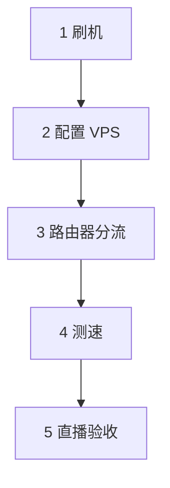

# OpenWrt / VPS 网络排障指南

[English](README.en.md) · [案例与历史](docs/cases.md) · [最新进度](docs/latest-progress.md)

Wi-Fi 连上了却打不开网页、下载到一半卡住，或者测速正常但直播掉帧？用这个仓库先在自己的电脑上做一次小检查，再按结果找下一步。

| 我想做什么 | 从这里开始 |
|---|---|
| 从零搭一条直播网络 | [按五步搭建并验收](#搭建与验收流程) |
| 先看一份报告，了解每一行是什么意思 | [直接看结果示例](docs/result-examples.md)，在网页上就能读 |
| 检查自己的网络，看看请求卡在哪一步 | [第一次运行](#第一次运行) |
| 确认两路直播能否同时跑 | [双路推流实测](docs/us-dual-rtmp-2026-11-16.md) · [手机直播验收表](docs/acceptance-and-rollback.md#手机验收表) |
| 给锐捷 RG-X60 PRO 准备固件或核对首刷流程 | [固件准备](docs/x60-pro-firmware-preparation.md) · [V2.00 原厂首刷案例](docs/x60-pro-stock-to-kwrt-v2.md) |

## 搭建与验收流程



按图中的编号打开对应教程，确认这一行的结果后再往下做。

| 步骤 | 对应教程 | 做到什么再继续 |
|---|---|---|
| 1 刷机 | [核对型号、下载、校验与分区](docs/x60-pro-firmware-preparation.md) · [RG-X60 PRO V2.00 原厂首刷](docs/x60-pro-stock-to-kwrt-v2.md) | 用适配硬件版本的固件，留好原机备份。重启后能通过网线打开路由器管理页。 |
| 2 配置 VPS | [配置并验证 VPS](docs/vps-and-router-setup.md#配置并验证-vps) | 先用电脑代理客户端连通服务，核对公网出口与预期一致。 |
| 3 路由器分流 | [在路由器上配置分流](docs/vps-and-router-setup.md#在路由器上配置分流) | 先让一台测试设备走指定出口，再核对管理页和原网络仍可用。 |
| 4 测速 | [小请求检查](docs/beginner-check.md#2-对自己的网络做一次小检查) · [完整下载](docs/measurement-guide.md#2-固定对象完整测五次) · [持续上传](docs/measurement-guide.md#4-受限持续上传与小请求回归) | 在准备开播的 Wi-Fi 上测，记录超时和完成率。按计划的并发数测试，确认上传能持续覆盖总码率并留有余量。 |
| 5 直播验收 | [手机实播验收表](docs/acceptance-and-rollback.md#手机验收表) · [双路 RTMP 实测案例](docs/us-dual-rtmp-2026-11-16.md) | 用实际设备和平台，按计划的并发路数试播 20～30 分钟。记录掉帧、卡顿和重连，有晚高峰使用需求时在对应时段复测。 |

路由器已装好兼容固件并能登录管理页，可以从第 2 步开始。VPS 已在电脑上验证过出口，可以从第 3 步开始。只想排查已有线路，直接从第 4 步测实际使用的 Wi-Fi。

## 第一次运行

以下命令在 **macOS 或 Linux 的终端**运行。演示需要 **Python 3.10 或更新版本**，可用 `python3 --version` 检查。

### 1. 用离线示例练习读报告

在 GitHub 点 **Code → Download ZIP**，解压后在终端进入包含 `README.md` 和 `tools/` 的文件夹。已安装 Git 的读者可以运行下面两行，下载并进入仓库。

```sh
git clone https://github.com/wukai8775-max/openwrt-vps-streaming-diagnostics.git
cd openwrt-vps-streaming-diagnostics
```

```sh
python3 tools/quick-check.py
```

报告开头会写「离线合成示例」。你会看到 **小请求 3/3 成功**，但 **下载只有 1/2 完整**，另一轮只收到部分数据就超时。这一步只读取项目内的示例数据。[逐项解释](docs/result-examples.md)

### 2. 检查自己当前的网络

实际检查另需 **curl 8.4 或更新版本**，可用 `curl --version` 检查。运行第一行查看计划，再运行第二行发起检查。

```sh
python3 tools/quick-check.py --plan
python3 tools/quick-check.py --execute
```

默认通过电脑当前的 IPv4 路由，向一个公开网站顺序发起最多 **3 次小请求**，每次最多 **5 秒**。这一步需要网络连接，只检查请求能否完成。出现「名称解析失败」「连接未建立」「加密连接失败」时，按报告里的提示查对应环节。[检查目标、流量预算和报告保存方法](docs/beginner-check.md)

## 按问题找案例

| 遇到的情况 | 已测到什么 |
|---|---|
| Wi-Fi 一连就弹回 | 澳洲线路从九组无法取得地址排查到无线接入，修复后十五组均实连并核对原出口。[接入复盘](docs/au-wifi-association-2026-11-11.md) |
| 下载有进度，最后还是超时 | 两轮已收到部分内容，完整性检查仍判为失败。报告分开记录原失败和后续短时复查。[下载复查](docs/au-group-12-followup-2026-10-21.md) |
| 想确认两路上传能否持续 | 美国线路两路各约 **4.19 Mbps**，同时推送 **20 分 02 秒**，各收齐 **36,000 帧**。测试用一台电脑向受控接收端推流。双手机实际开播待测。[双路推流记录](docs/us-dual-rtmp-2026-11-16.md) |

## 需要进一步排查

- 想检查指定线路或固定大小的文件，先看 [进阶准备](docs/advanced-start.md)，再按 [分层决策树](docs/decision-tree.md) 和 [采集与测量](docs/measurement-guide.md)。
- 已经找到一个可能有效的参数，先记录原配置，再按 [单项实验卡](docs/experiment-card.md) 和 [验收与回滚](docs/acceptance-and-rollback.md) 做对照。
- 正在刷机且卡在某一步，按硬件版本核对 [固件、校验与分区](docs/x60-pro-firmware-preparation.md)，再看 [现场问题复盘](docs/x60-pro-flashing-troubleshooting.md)。
- 已有排查记录，准备交接给别人，先看 [最新进度](docs/latest-progress.md) 和 [案例索引里的交接入口](docs/cases.md#agent-接手与深入排查)。

反馈问题时附上症状、测试条件和「完成 / 尝试」次数。公开前请把地址、Wi-Fi 名称、登录信息、配置备份和原始日志留在私有位置。[故障表单](https://github.com/wukai8775-max/openwrt-vps-streaming-diagnostics/issues/new?template=diagnostic-report.yml) · [公开边界](SECURITY.md)

[贡献指南](CONTRIBUTING.md) · [环境记录](docs/environment.md) · [更新日志](CHANGELOG.md) · [MIT License](LICENSE) · [离线 CI](https://github.com/wukai8775-max/openwrt-vps-streaming-diagnostics/actions/workflows/ci.yml)
