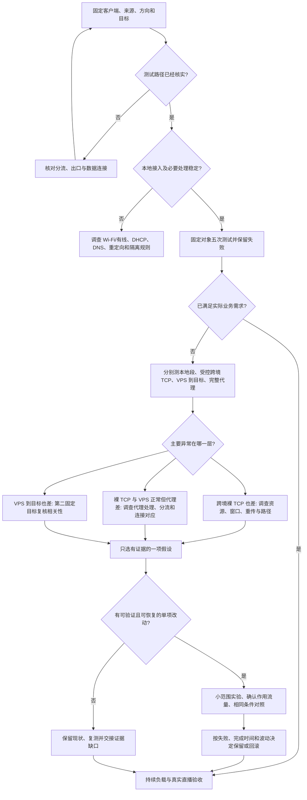

# 从“卡顿”快速缩小到一层

先记录这句话：**哪台客户端，通过哪个接口/业务网络，经过哪条代理连接，向哪个固定目标，正在上传还是下载？** 如果说不清，先确认路径；出口 IP 或 SSID 名称只有单项信息，不能替代完整路径。

## 前 15 分钟先做这些

| 检查 | 最低记录 | 处理方式 |
| --- | --- | --- |
| 可恢复 | 已验证的本地管理入口、VPS 控制台/SSH、备份保存位置 | 生产接口或规则改动前能恢复 |
| 接入与来源 | 当前业务网络、接口、DHCP 地址、绑定的来源地址 | 网络切换后重新核对；不要沿用旧地址 |
| 必要连通性 | 路由器、DNS、代理重定向、本地处理规则 | 有拒绝时找实际处理位置；不要全局关闭防火墙 |
| 完整业务 | 一个固定 HTTPS 对象、大小、超时、五次全部结果 | 成功、失败、部分下载均记录 |
| 实际连接 | 测试时两端数据 socket、发送方向、CPU/队列/重传增量 | 日志时间对齐；端口和进程存在只是入口信息 |

网关 ICMP 被拒绝不等于无线链路丢包。完整请求失败也不自动等于运营商故障。先核实规则，再解释结果。

## 分层决策图

图中的分支只是调查方向，单个测试不能宣布根因。

## 常见现象与下一步

| 现象 | 优先调查 | 不能直接得出的结论 |
| --- | --- | --- |
| 有 Wi-Fi 信号、DHCP 正常，但代理/DNS 不通 | 隔离区域对本地重定向处理的规则、DNS 路径 | Wi-Fi 硬件坏了或海外节点宕机 |
| 闲时延迟正常，一上传就卡 | 上传负载是否超预算、队列和资源、真实上行容量 | 必须增大全部 TCP 缓冲区 |
| 大文件变快，但小请求偶发接近秒级 | 外层连接重传、连接恢复、目标侧时延、冷/热连接差异 | 直播已经完全稳定 |
| 默认 `tcp_congestion_control=bbr`，业务仍慢 | 下载方向发送端、实际数据连接、旧连接复用、路径与目标 | 每条业务连接都已使用 BBR |
| iperf 达到 20 Mbps，业务测速也接近 20 Mbps | iperf 的 `-b`、每条流限制、业务和服务商配置 | 线路天然最高只有 20 Mbps |
| 路由器系统丢弃计数增长 | 计数位置、增量时间窗、其他流量、相关接口 | 这是目标节点的精确丢包率 |
| STUN 超时、HTTP 成功 | 固定目标、映射和承载路径、请求期限 | 所有 UDP 媒体丢包率等于 STUN 超时率 |
| VPS 本机访问快、客户端慢 | 受控跨境 TCP 与完整代理分别复核 | 已找出具体运营商或损伤一跳 |

## 判断配置实际作用到了哪条连接

下载方向应看向客户端发送数据的 VPS socket；上传方向应看向 VPS 发送数据的路由器/客户端 socket。监听连接、SSH 管理连接和 iperf 控制连接都不能代替业务数据连接。

切换默认拥塞控制后，已经建立的连接可能继续保持原状态。应该核对新建且确实传输数据的连接，以及方向和字节增量；是否需要刷新连接池由实际证据和维护窗口决定，避免在正在直播时为验证而中断会话。[Linux TCP 参数文档](https://docs.kernel.org/networking/ip-sysctl.html)给出默认算法语义；具体内核和程序仍需实测。

iperf3 的 `-C` 和 `-M` 修改测试连接，不能把测试选项直接当成 Xray 业务已修改的证据。`-R` 反转数据方向，`-b` 是测试目标速率且对并行流分别应用。版本和可用选项先用本机 `iperf3 -v` / `iperf3 -h` 核对。[iperf3 官方参数说明](https://software.es.net/iperf/invoking.html)。

## 到这里就可以作出决定

满足业务需求且没有可安全验证的候选改动时，进入验收。证据不足时保留当前配置，并写明缺失的数据。不要为了写出一组新参数而改生产系统。
